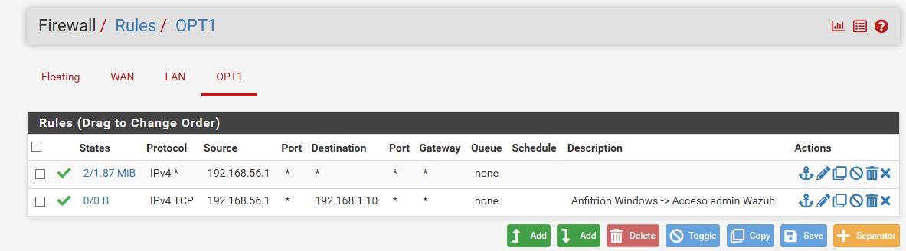

# Enrutamiento, pfSense y Conectividad

Para permitir la administración de Wazuh desde el equipo Windows hacia la red interna del laboratorio `LAN`, sin romper el aislamiento del firewall, se configuró una red de gestión mediante un adaptador **Host-Only** combinada con una ruta estática y una regla de control de acceso.

## 1. Configuración de Enrutamiento en el Host (Windows)
Ya que el adaptador Host-Only no cuenta con puerta de enlace predeterminada hacia la subred interna del laboratorio (`192.168.1.0/24`), se configuró una ruta estática en el sistema operativo anfitrión:

```cmd
route -p ADD 192.168.1.0 MASK 255.255.255.0 192.168.56.2
```

## 2. Autorización de Tráfico de Gestión en pfSense (Interfaz OPT1)
Para permitir que el equipo anfitrión se comunique de forma segura con el servidor Wazuh a través de la interfaz de gestión (`OPT1`), se implementó una regla de filtrado estricta en el firewall:

| Interfaz | Acción | Protocolo | Origen (Source) | Destino (Destination) | Puerto | Descripción |
| :--- | :--- | :--- | :--- | :--- | :--- | :--- |
| **OPT1** | `Pass` | `IPv4 *` | `192.168.56.1` | `*` | `*` | Tráfico general desde el host de gestión |
| **OPT1** | `Pass` | TCP | `192.168.56.1` (Host) | `192.168.1.10` (Wazuh) | `443` (HTTPS) | Permitir acceso administrativo de gestión al Dashboard |

* **Propósito de la regla:** Autoriza exclusivamente el tráfico proveniente de la IP de administración del host anfitrión hacia el puerto de control del SIEM, manteniendo el segmento aislado frente a otras posibles interfaces externas.

*Evidencia de la regla aplicada:*

